# Aegisub AI KFX Studio

A complete, ready-to-run **Google Colab** Jupyter Notebook ([aegisub-ai-kfx-studio.ipynb](aegisub-ai-kfx-studio.ipynb)) that automates **Anime Romaji Karaoke (KFX)** creation in two modular stages.

- **Path A (Full Pipeline — Stage 1 -> Stage 2):** Upload raw anime OP/ED audio or video (`.mp3`, `.wav`, `.flac`, `.mp4`, `.mkv`) + line-timed romaji lyrics, isolate vocals with **Meta Demucs (`htdemucs`)**, auto-time syllables into `auto_timed_karaoke.ass` using forced alignment + a Japanese Mora Syllabifier, and synthesize multi-layer KFX into `final_kfx_karaoke.ass`.
- **Path B (Skip Stage 1 — Stage 2 Only):** Already have a `\k` / `\kf` / `\ko`-timed `.ass` file? Skip Stage 1 completely, upload your timed `.ass` + `.ttf`/`.otf` font into **Stage 2**, inspect your numbered lines in the **Line Inspector Table**, choose either **Mode A (Shared KFX Animation + Line-Range Colors)** or **Mode B (Unique KFX Animation + Colors per Line Range)**, preview any line in Colab, and download `final_kfx_karaoke.ass`.

---

## Workflow Architecture

```mermaid
flowchart LR
    A["Raw Audio or Video (.mp3, .wav, .mp4, .mkv)"] --> B["1.3 Demucs Vocal Stem (htdemucs)"]
    L["Line-Timed Romaji (.ass, .srt, or pasted)"] --> C["1.4 Forced Alignment (MMS_FA / WhisperX)"]
    B --> C
    C --> D["Japanese Mora Syllabifier"]
    D --> E["auto_timed_karaoke.ass"]
    E --> F["2.1 Load .ass + Font & Line Inspector Table"]
    U["Existing \\k-timed .ass (Skip Stage 1)"] --> F
    F --> G["2.2 FreeType/OS2 Layout Math"]
    G --> T{"2.3 KFX Mode Toggle"}
    T -->|"Mode A: Shared Animation"| MA["Compile 1 Master Effect + Apply Per-Range 4-Color Palettes"]
    T -->|"Mode B: Unique Per Section"| MB["Compile Unique Effect + Colors Per Line Range"]
    MA --> K["2.4 Unified final_kfx_karaoke.ass"]
    MB --> K
    K --> M["2.5 FFmpeg/libass Section Preview & Download"]
```



---

## Quick Start on Google Colab

1. **Open the notebook:** Upload [`aegisub-ai-kfx-studio.ipynb`](aegisub-ai-kfx-studio.ipynb) to [Google Colab](https://colab.research.google.com/) (or open it directly from GitHub).
2. **Choose your runtime:**
   - **Running Stage 1 (Demucs + Forced Alignment):** Select `Runtime -> Change runtime type -> T4 GPU` (or L4).
   - **Skipping Stage 1 (Stage 2 KFX Engine only):** Standard **CPU** runtime is fast and sufficient.
3. **Run Cell `0. Core Setup`** (always required — initializes Colab/local paths, optionally mounts Google Drive when `MOUNT_GOOGLE_DRIVE = True`, installs `pillow`, `fonttools`, `google-genai`, `ipywidgets`, and checks `ffmpeg` + `libass`).
4. *(Optional, for Google Drive files)* To load audio, video, `.ass`/`.srt` lyrics, or `.ttf`/`.otf` fonts straight from Google Drive instead of uploading them via browser:
   - Tick `MOUNT_GOOGLE_DRIVE = True` in **Cell `0. Core Setup`** (or simply pick a `"Use Existing / Mounted Drive ..."` mode in Cell `1.2` / `2.1`, which auto-mounts Drive at `/content/drive` in Colab).
   - Tip: Leaving `EXISTING_PATH_OR_MOUNTED_PATH` (or pointing it to a Drive folder like `/content/drive/MyDrive/Anime`) lists all matching files in that directory (with copy-pasteable paths and an interactive dropdown in Colab).
5. *(Optional, for AI Prompt mode)* Add your Gemini API key:
   - Recommended: Open Colab's **Secrets** (key icon on the left sidebar), add a secret named `GEMINI_API_KEY`, and enable notebook access.
   - Or paste your key directly into the `GEMINI_API_KEY` form field in **Cell 2.3**.
   - **No API key?** Leave `GENERATION_MODE` on `"Offline Built-in Preset (No API Key Needed)"` to use all 8 customizable presets completely free and offline.

---

## Stage 1 (Optional): AI Vocal Separation & Romaji Syllable Auto-Timer

> **Skip Cells `1.1` – `1.4` if you already have a `\k` / `\kf` / `\ko`-timed `.ass` file.**

### 1.1 Stage 1 Setup
Choose `ALIGNMENT_ENGINE`:
- `torchaudio_mms_fa` *(default, recommended)*: Uses `torchaudio.pipelines.MMS_FA` for robust, lightweight word-level forced alignment against romaji tokens.
- `whisperx`: Optional WhisperX forced-alignment backend (`language_code="ja"`).

### 1.2 Inputs: Media & Line-Timed Lyrics
- **Audio / Video (`AUDIO_SOURCE` & `EXISTING_PATH_OR_MOUNTED_PATH`):**
  - Choose `"Upload Audio/Video File"` to upload from your computer, **or** `"Use Existing / Mounted Drive Path"` and enter the file path (e.g., `/content/drive/MyDrive/Anime/op.mkv` or `MyDrive/Anime/op.mp3`) in `EXISTING_PATH_OR_MOUNTED_PATH`. Leave it blank or pass a Drive folder path to list matching media files automatically.
  - Supports `.mp3`, `.wav`, `.flac`, `.ogg`, `.m4a`, `.aac`, `.mp4`, `.mkv`, `.webm`, and `.mov` (automatically extracted to 44.1 kHz stereo WAV via `ffmpeg`).
- **Line-Timed Romaji Lyrics (`LYRICS_INPUT_MODE`):**
  - Upload a line-timed `.ass` or `.srt` file, **or** select `"Use Existing / Mounted Drive Lyrics File"` and specify `LYRICS_FILE_PATH` (existing `\k` tags, if any, are stripped cleanly while preserving line timestamps), **or**
  - Paste line-timed lyrics directly in `PASTED_LYRICS` using any of these formats:
    ```text
    # Bracketed start - end
    [00:01.20 - 00:05.60] Hikari wo sagashite yozora wo kakete yuku

    # ASS-style CSV
    0:00:05.80,0:00:10.40,Zutto kawaranai omoi wo dakishimete

    # Arrow + pipe
    00:10.60 --> 00:15.20 | Kon'ya hoshi no shita de chikau yo Starlight

    # LRC (end inferred from next line)
    [00:15.40] Arigatou itsumo soba ni ite kurete
    ```

### 1.3 Vocal Isolation (`htdemucs`)
Runs Meta's Demucs (`htdemucs` or `htdemucs_ft`, `--two-stems=vocals`) on the extracted audio so electric guitars, drums, and synths don't interfere with alignment, resamples the vocal stem to 16 kHz mono, and embeds a 20-second audio preview in Colab.

### 1.4 Forced Alignment & Japanese Mora Syllabifier
Aligns each line's words against the isolated vocal stem, splits each romaji word into Japanese morae, distributes each word's centiseconds proportionally (`sum(\k) == word_duration_cs`), and writes `auto_timed_karaoke.ass`.

**Syllabifier Rules & Options:**
- Handles standard CV (`ka, ki, ku, ke, ko`), palatalized yōon/digraphs (`sha, chu, ryo, kya, nya, tsu, dzu`), standalone vowels (`a, i, u, e, o` and macrons `ā, ī, ū, ē, ō`), standalone moraic `n` (`minna` -> `mi, n, na`; `senpai` -> `se, n, pa, i`) and `m` before `b/p/m` (`sempai` -> `se, m, pa, i`), and apostrophe breaks (`kon'ya` -> `ko, n', ya`; `shin'ai` -> `shi, n', a, i`).
- `SPLIT_SOKUON_AS_MORA`:
  - `True`: `zutto` -> `zu`, `t`, `to`; `matcha` -> `ma`, `t`, `cha`; `kocchi` -> `ko`, `c`, `chi`
  - `False`: `zutto` -> `zut`, `to` (2x mora weight on `zut`); `matcha` -> `mat`, `cha`
- `SPLIT_LONG_VOWELS`:
  - `True`: `arigatou` -> `a`, `ri`, `ga`, `to`, `u`
  - `False`: `arigatou` -> `a`, `ri`, `ga`, `tou` (2x mora weight on `tou`)
- Preserves capitalization, punctuation (`Kokoro,`, `(yume!)`), hyphens (`ano-hi`), and falls back cleanly on English words embedded in anime OPs (`Starlight`, `Dream`, `Yeah!`).

You can set `DOWNLOAD_STAGE1_ASS = True` to inspect/tweak `auto_timed_karaoke.ass` in Aegisub before continuing, or proceed straight to **Cell 2.1**.

---

## Stage 2 (Core): Prompt-Driven AI KFX Animation Engine

### 2.1 Load Timed `.ass`, Font (`.ttf` / `.otf`) & Line Inspector Table
Choose `ASS_SOURCE`:
1. `"Upload existing \k/\kf-timed .ass file"` — upload your own timed `.ass` file.
2. `"Use Existing / Mounted Drive .ass Path"` — load an `.ass` file from local disk or mounted Google Drive via `ASS_FILE_PATH` (pass a folder path to list matching `.ass` files).
3. `"Use auto_timed_karaoke.ass from Stage 1"` — pass Stage 1's output directly.
4. `"Use Built-in Anime Romaji Demo .ass (Instant Test)"` — test Stage 2 immediately with a 6-line multi-style demo (`Romaji_Verse` on Lines 1–3, `Romaji_Chorus` on Lines 4–6).

Choose `FONT_SOURCE`:
- `"Auto System Font / Fallback"` — auto-detects an installed system font or falls back to calibrated proportional metrics.
- `"Upload .ttf/.otf Font File"` — upload the `.ttf`/`.otf` font used by your subtitle style so Pillow/FreeType measures exact glyph widths and kerning.
- `"Use Existing / Mounted Drive Font Path"` — load a `.ttf`/`.otf`/`.ttc` font file directly from `FONT_FILE_PATH` (e.g., `/content/drive/MyDrive/Fonts/MyFont.ttf`).

Right after loading, Cell `2.1` prints and displays an **Interactive Line Inspector Table** showing `Line #1..#N`, `Start Time`, `End Time`, `Style Name`, syllable count, and tag-stripped clean lyrics so you can pick exact ranges for your intro, verse, chorus, and outro.

### 2.2 Exact Syllable, Character & Word Layout + Vector Math Engine
Parses `[Script Info]`, `[V4+ Styles]`, and `[Events]` (`\k`, `\kf`, `\K`, `\ko`, multiple tags per `{...}`, plus line-level `\an1`–`\an9`, `\pos`, `\fs`, `\fscx`, `\fscy`, `\fsp` overrides). Using **`OS/2` (`usWinAscent + usWinDescent`) GDI/libass-calibrated FreeType metrics** via `fontTools` + Pillow prefix-width differences across the entire line, it computes exact non-overlapping coordinates for every line, word, syllable, and individual character (`syl.chars`, `line.words`), plus cross-line continuity (`line.prev_line`, `line.next_line`, `line.progress`):
- `left`, `center`, `right`, `width`
- `top`, `middle`, `bottom`, `height`
- `x` (`center`), `y` (`middle`), `start_ms`, `end_ms`, `duration_ms`
- Per-character (`CharBox` inside `syl.chars`) and word-group (`WordBox` inside `line.words`) geometry & timing
- Real glyph outline extraction (`glyph_to_ass_path`) & interior/contour glyph pixel sampling (`sample_glyph_pixels`) using the active font file

Optional spacing fine-tuning parameters in Cell `2.2`:
- `WIDTH_CALIBRATION_SCALE` (default `1.0`): multiplicative horizontal width scale (`< 1.0` pulls syllables closer together; `> 1.0` spreads them apart).
- `EXTRA_SYLLABLE_SPACING_PX` (default `0.0`): additive per-character spacing in pixels (`-1.0` to `-3.0` tightens syllables; positive values widen gaps).

### 2.3 KFX Mode Toggle, Rule & Palette Builder (`ipywidgets` UI + JSON Config)
Configure `KFX_RULE_MODE`, `GENERATION_MODE` (`"Offline Built-in Presets (No API Key Needed)"` or `"AI Prompt-Driven Generator (Gemini API)"`), `CONFIG_MODE` (`"Interactive UI (ipywidgets Rule Builder)"` or `"JSON Config (Edit JSON Below)"`), and global physics/seed parameters (`PARTICLE_DENSITY`, `MOTION_INTENSITY`, `RANDOM_SEED`).

You can switch seamlessly at the top of the UI widget (or via `KFX_RULE_MODE`):

#### Mode A: Shared KFX Animation + Line-Range Colors
Best when you want **100% identical motion, physics, particle shapes, and timing** across the whole song while smoothly shifting color palettes between verse, pre-chorus, chorus, and outro:
- **Master KFX Prompt (`MASTER_KFX_PROMPT`) & Master Preset (`MASTER_PRESET`):** Defined once at the top and **compiled only once** (either 1 Gemini API call or 1 built-in preset).
- **Color Palette Rules (`+ Add Color Range` / `COLOR_PALETTES_JSON_CONFIG`):** Lightweight color-only cards without duplicate prompts:
  - **Target Selector Mode:** `"Line Number Range"` (e.g., `1-3`, `4-6, 10-end`), `"ASS Style Name"` (with detected style quick-pick), or `"All Remaining Unassigned Lines"`.
  - **4 Color Pickers (Auto-Converted to ASS `&HBBGGRR&`):**
    1. `Primary (\1c)` -> `palette["primary_1c"]`
    2. `Highlight (\2c)` -> `palette["highlight_2c"]`
    3. `Glow/Border (\3c)` -> `palette["glow_3c"]`
    4. `Particle (\p1)` -> `palette["particle_c"]`
- **Unified Synthesis:** Loops through Lines `1..N` chronologically and passes each line's matched `palette` dict into the single compiled master function.

```json
// COLOR_PALETTES_JSON_CONFIG (used in Mode A when CONFIG_MODE == "JSON Config (Edit JSON Below)")
[
  {
    "name": "Verse Palette (Cool Cyan & Ice)",
    "target_mode": "Line Number Range",
    "target_value": "1-3",
    "primary_hex": "#67E8F9",
    "highlight_hex": "#E0F2FE",
    "glow_hex": "#0284C7",
    "particle_hex": "#A5F3FC"
  }
]
```

#### Mode B: Unique KFX Animation + Colors per Line Range
Best when you want completely different effects per section (`+ Add KFX Section Rule` / `RULES_JSON_CONFIG`)—for example, floating water bubbles on Lines `1-3` and explosive crimson-gold bounce on Lines `4-6`:
- **Target Selector Mode & Target Value:** `"Line Number Range"`, `"ASS Style Name"`, or `"All Remaining Unassigned Lines"`.
- **4 Color Pickers:** `Primary (\1c)`, `Highlight (\2c)`, `Glow/Border (\3c)`, and `Particle (\p1)`.
- **Per-Rule Creative KFX Prompt & Fallback Preset Selector:** Compiles an independent animation function for each active rule.

```json
// RULES_JSON_CONFIG (used in Mode B when CONFIG_MODE == "JSON Config (Edit JSON Below)")
[
  {
    "name": "Verse (Calm Blue Glow & Bubbles)",
    "target_mode": "Line Number Range",
    "target_value": "1-3",
    "primary_hex": "#67E8F9",
    "secondary_hex": "#E0F2FE",
    "outline_hex": "#0284C7",
    "particle_hex": "#A5F3FC",
    "preset": "sparkle_trail",
    "prompt": "Soft calm blue glow, slow fade-in, gentle floating water bubbles \\p1"
  }
]
```

- **Shared Toolbar Actions:** `+ Add Color Range` / `+ Add KFX Section Rule`, `Delete Range` / `Delete Rule`, `Validate Line Mapping` (checks overlaps and unassigned lines), `Export Config JSON`, and **`Generate Full KFX .ass`** (compiles immediately with an inline download button).

#### 8 Built-In Offline Presets (All 4 Palette Colors `\1c`, `\2c`, `\3c`, `\p1` Aware)
| Preset Name | Layers & Visual Style |
| :--- | :--- |
| `neon_glow_bounce` | **Layer 0:** Dark outline + pulsing blurred `\3c` neon aura. **Layer 1:** Elastic 2-segment `\move` upward syllable bounce + `\2c -> \1c` flash. **Layer 2:** Radial burst of spinning `\p1` 4-point stars & circles using `particle_c`. |
| `sakura_petals` | **Layer 0:** Warm shadow + `\3c` blossom aura. **Layer 1:** `\2c -> \1c` blossom swell on hit. **Layer 2:** Drifting `\p1` cherry blossom petals using `particle_c` with wind drift and `\frx`/`\fry`/`\frz` tumbling. |
| `gradient_clip_wipe` | **Layer 0–1:** Clean shadow + base fill. **Layer 2:** 5-band vertical `\1c -> \2c` gradient via `\clip` strips with `\3c` outline wiping left-to-right across each syllable. **Layer 3:** Sweeping leading-edge `star4` shimmer glint colored with `particle_c`. |
| `shatter_disintegrate` | **Layer 0–1:** High-impact hit flash (`\fscx122\fscy122`) followed by rapid blur/dissolve. **Layer 2:** Grid of randomized crystalline `\p1` shard polygons driven by `particle_c` erupting across the syllable bounding box with fast `\frz` spin. |
| `sparkle_trail` | **Layer 0–2:** `\3c` glow halo + smooth `\clip` transition (`\2c -> \1c`). **Layer 3:** Progressive comet trail of twinkling `star4`/`diamond` (or floating `circle` bubbles when `"bubble"` is in the prompt) colored with `particle_c` spawning from `syl.left` to `syl.right`. |
| `sky_clouds_backdrop` | **Layer 0:** Rounded multi-band sky gradient banner behind the entire line (`make_rounded_rect`, bridged cleanly across consecutive lines with `line_bridge_times`). **Layer 1:** Soft blurred `cloud` vectors drifting left-to-right clipped inside the sky banner. **Layer 2–4:** Crisp `\clip`-lit syllables above the clouds + subtle `particle_c` shimmer motes. |
| `multi_slash_exit` | **Layer 0–1:** Crisp shadow + punchy `\1c` hit hold. **Layer 2:** Frame-by-frame (`FBF`) multi-cut diagonal polygon split using `slice_bbox_polygons` + `fbf_steps` + `transform_polygon` so sliced glyph halves spin apart cleanly. **Layer 3:** Crossing `slash` & `crescent` katana beams + diagonal `particle_c` sparks. |
| `pixel_dust_dissolve` | **Layer 0–1:** Cross-line aura + cascading per-character (`syl.chars`) bounce & sweep using `ease(..., "out_back")`. **Layer 2:** True glyph-shaped `sample_glyph_pixels(syl)` dust/pixel particles eroding outward along curved cubic `bezier_point` trajectories with `particle_c`. |

#### AI Prompt-Driven Generator (`google-genai`)
Set `GENERATION_MODE = "AI Prompt-Driven Generator (Gemini API)"`, choose a model (`gemini-4-hydrogen`, `gemini-4-neon`, `gemini-4-argon`, or `gemini-4-carbon`), and set `GEMINI_THINKING_LEVEL` (`"low"` default to keep reasoning fast without hitting token caps, or `"medium"`/`"high"` recommended for complex scenes).
- **Opt-In AI Visual Self-Review (Credit Saver):** `ENABLE_AI_VISUAL_REVIEW` (checkbox in the UI / form field in Cell `2.3`) defaults to **`False`** so zero extra API credits are spent unless you check it. When enabled, Stage 2 automatically renders a 3-frame `ffmpeg` + `libass` contact sheet (`Start`, `Mid-Hit`, `Trail/Exit`) and sends it to Gemini to spot and fix spacing, clipping, or `\p1` geometry issues.
- **Interactive Follow-Up Tweak Box:** After generating `.ass` output, enter plain-English adjustments (e.g., *"slow down the chain swing and brighten the glow"*) in the UI's **Follow-Up Tweak** bar and click **Apply AI Tweak & Rebuild .ass** to refine the active rule or master effect iteratively without regenerating the whole project.
- In **Mode A**, Gemini is called **once** for `MASTER_KFX_PROMPT`, and the generated code is automatically dry-run verified across two contrasting `palette` dicts so colors are never hardcoded and always swap cleanly per range.
- In **Mode B**, each matched rule generates its own dedicated, AST-sandboxed `generate_line_kfx` function using that rule's colors and prompt.

Example creative prompts to try:
1. *"Soft cyan neon glow when each syllable hits, gentle upward bounce, and tiny 4-point star vector particles `\p1` bursting from the syllable center and fading out."*
2. *"Golden fire embers rising upward with subtle flicker, warm orange glow aura on Layer 0, and crimson-to-gold sweep on Layer 1."*
3. *"Rounded gradient sky banner behind the entire line on Layer 0 with blurred white vector clouds drifting left-to-right clipped inside the banner, crisp karaoke wipe above, and floating stars."*
4. *"When each syllable ends, flash two crossing diagonal katana slash streaks and slice the syllable cleanly into rotating polygon halves that fly apart in 35ms FBF steps."*
5. *"Gentle musical notes (`music_note`) floating upward along a sine arc as each syllable sings, with pastel lavender outline glow."*

### 2.4 & 2.5 Unified Compilation, Section Preview & Download
- **Cell 2.4** (or the **`Generate Full KFX .ass`** button in Cell `2.3`) maps every line `1..N` to its Color Range (Mode A) or Section Rule (Mode B), reports any overlap warnings and auto-fallback assignments, executes each line in chronological order while preserving exact syllable `(x, y)` geometry, sorts all generated multi-layer `Dialogue:` events, and saves `final_kfx_karaoke.ass`.
- **Cell 2.5** uses `ffmpeg` + `libass` (with `:fontsdir=fonts`) to render the specific rule & palette assigned to **1-based `PREVIEW_LINE_NUMBER`** (e.g., Line `1` for Verse, Line `4` for Chorus) as a 3-frame keyframe contact sheet + optional MP4 clip inline, then downloads `final_kfx_karaoke.ass`.

---

## KFX Engine Python API Reference (For Custom/AI Functions)

Every preset and AI-generated function implements (with backwards compatibility for legacy 6-arg functions omitting `palette`):

```python
def generate_line_kfx(line, style, meta, helpers, rng, config, palette) -> list[str]:
    ...
```

- `line` (`KaraokeLine`): `index`, `start_ms`, `end_ms`, `duration_ms`, `style`, `alignment`, `left`, `center`, `right`, `top`, `middle`, `bottom`, `width`, `height`, `x`, `y`, `scale_x`, `scale_y`, `plain_text`, `syllables`, `words` (`WordBox` list), `prev_line`, `next_line`, `total_lines`, `progress` (`0.0`–`1.0` across the song)
- `syl` (`Syllable`): `index`, `word_index`, `text`, `raw_text`, `k_type`, `start_ms`, `end_ms`, `duration_ms`, `rel_start_ms`, `rel_end_ms`, `left`, `center`, `right`, `top`, `middle`, `bottom`, `width`, `height`, `x`, `y`, `is_space`, `chars` (`CharBox` list with per-character `text`, `index`, `line_char_index`, `left`, `center`, `right`, `top`, `middle`, `bottom`, `width`, `height`, `x`, `y`, `start_ms`, `end_ms`, `duration_ms`)
- `word` (`WordBox`): `index`, `text`, `start_ms`, `end_ms`, `duration_ms`, `left`, `center`, `right`, `top`, `middle`, `bottom`, `width`, `height`, `x`, `y`, `syllables`
- `palette` (`dict`): `primary_1c` (`\1c`), `highlight_2c` (`\2c`), `glow_3c` (`\3c`), `particle_c` (`\p1`), plus `primary_hex`, `highlight_hex`, `glow_hex`, `particle_hex`
- `config` (`dict`): `particle_density`, `motion_intensity`, `rule_name`, `prompt`, `palette` (plus compatibility keys `primary_hex`, `secondary_hex`, `outline_hex`, `particle_hex`, `primary_ass`, `secondary_ass`, `outline_ass`, `particle_ass`)
- `helpers` (`KFXHelpers`):
  - `ass_color("#RRGGBB")` -> `"&HBBGGRR&"` (converts RGB to ASS BGR)
  - `ass_alpha(0..255)` -> `"&HXX&"`
  - `lerp(a, b, t)`, `clamp(val, lo, hi)`, `lerp_color(hex1, hex2, t)`
  - `ease(t, kind="out_cubic")` (`linear`, `in_quad`, `out_quad`, `in_out_quad`, `in_cubic`, `out_cubic`, `in_out_cubic`, `in_sine`, `out_sine`, `in_out_sine`, `in_back`, `out_back`, `out_elastic`, `out_bounce`) & `bezier_point(p0, p1, p2, p3, t)` (set `p3=None` for quadratic)
  - `make_event(layer, start_ms, end_ms, style_name, text, effect="fx", actor="")`
  - `make_rect(w, h)`, `make_rounded_rect(w, h, radius=12.0)`, `make_shard(w, h, rng)`
  - `make_chain_link(w=34.0, h=16.0, thickness=4.5)` — hollow rounded stadium chain link (`[0..w] x [0..h]` non-negative outer + reversed hole contour)
  - `make_ribbon(points, widths=6.0)` & `make_lightning(x1, y1, x2, y2, rng, segments=8, jitter=14.0, thickness=2.8)` — screen-space polygonal paths for `\an7\pos(0,0)`
  - `sample_glyph_pixels(syl, step=4, contour_only=False, max_points=260)` — samples real rasterized glyph interior/outline `(x, y)` points for particle dissolves and morphs
  - `glyph_to_ass_path(syl, absolute=False)` & `deform_ass_path(path_str, fn)` — converts syllable characters into true vector `\p1` paths (using `fontTools`) and applies wave/shatter distortions
  - `line_bridge_times(line, default_in_ms=260, default_out_ms=280, max_gap_ms=800)` — returns `(line_in, line_out, fade_in, fade_out)` using `prev_line` / `next_line` so backdrops never flicker between consecutive lyrics
  - `polygon_to_ass_path(points)`, `clip_polygon_halfplane(poly, px, py, nx, ny)`
  - `slice_bbox_polygons(left, top, right, bottom, cuts)` — splits a box across `(px, py, angle_deg)` cut lines
  - `shift_polygon(poly, dx, dy)`, `transform_polygon(poly, cx, cy, dx=0.0, dy=0.0, angle_deg=0.0)`
  - `fbf_steps(start_ms, end_ms, step_ms=35)` — centisecond-aligned `(f_start, f_end, progress)` frame steps for diagonal slicing & complex vector clips
- `SHAPES` dict (`\p1` vector drawings using non-negative `[0..w] x [0..h]` coordinates for exact `\an5` centering in `libass`): `star4`, `star5`, `petal`, `circle`, `diamond`, `heart`, `music_note`, `cloud`, `slash`, `crescent`, `lightning`, `ring`.

> **Tip for complex AI prompts:** Because `libass` cannot interpolate diagonal polygon `\clip(m ...)` inside `\t(...)`, tell the prompt to layer clipped backdrops cleanly (`\clip(bx1,by1,bx2,by2)`) or use FBF (`fbf_steps` + `slice_bbox_polygons` + `transform_polygon`) for diagonal syllable splits. Set `GEMINI_THINKING_LEVEL = "medium"` or `"high"` with `gemini-4-argon` / `gemini-4-carbon` for complex multi-layer choreography.

---

## Troubleshooting & Best Practices

- **Colors look swapped (cyan becomes orange, red becomes blue)?** ASS uses **`&HBBGGRR&`** (Blue-Green-Red), not RGB. Always use `helpers.ass_color("#RRGGBB")`.
- **Syllables look too far apart or too tight in Aegisub?**
  1. Make sure you upload/mount the **exact `.ttf`/`.otf` font file** (matching Regular vs. Bold) in Cell `2.1`—if Cell `2.2` warns that the measured fallback font differs from your style font, width metrics will diverge.
  2. You can fine-tune spacing anytime in Cell `2.2` using `WIDTH_CALIBRATION_SCALE` (e.g., `0.90`–`0.95` to tighten) and `EXTRA_SYLLABLE_SPACING_PX` (e.g., `-1.5`), then re-run Cells `2.2`–`2.5`.
- **Font looks slightly different in Aegisub or preview?** Upload the exact `.ttf`/`.otf` file in Cell `2.1` and make sure the same font is installed on your PC when opening `final_kfx_karaoke.ass` in Aegisub.
- **Stage 1 alignment slightly early/late on fast chorus lines?** Download `auto_timed_karaoke.ass` from Cell `1.4`, adjust those few `\k` values in Aegisub's karaoke timing mode, and upload the tweaked file into Cell `2.1`.
- **`\t` timing feels wrong in custom AI prompts?** Remember ASS `\t(t1, t2, ...)` times are always **milliseconds relative to that individual `Dialogue:` line's `Start` time**, not relative to the parent lyric line!
- **Stage 1 runs slowly on CPU?** Switch Colab to a **T4 GPU** (`Runtime -> Change runtime type -> T4 GPU`) before running Demucs (`Cell 1.3`).
